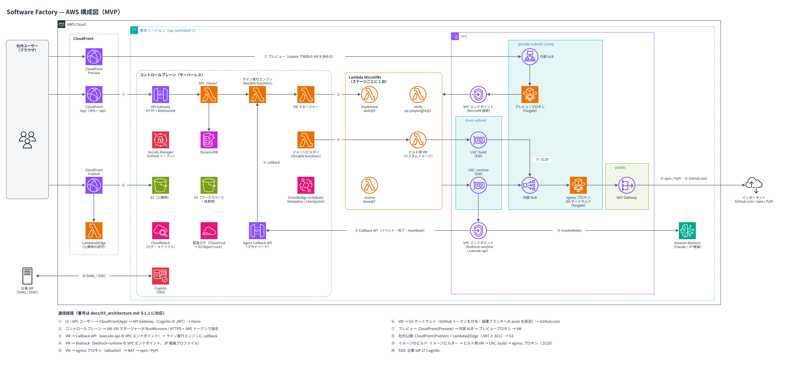

# Software Factory

AI コーディングエージェントに、**隔離された作業環境で、自律的にソフトウェアを作らせる**ための社内プラットフォームです。開発者だけでなく、業務部門（LoB）のユーザーも、Web のチャットから依頼して成果物を受け取れるようにします。

- 依頼の流れ: Web のチャットで依頼する → エージェントが**計画**を出す → 承認する → エージェントが Lambda MicroVM の中で作業する → **PR**・**ライブプレビュー**・**社内公開**・**ダウンロード**で受け取る
- 工程（ステージ）ごとに**別の VM と別のイメージ**を使う「ファクトリーライン」で、実装 → 検証 → レビューを分業させられます
- 統制はプロンプトではなく、エージェントが回避できない**インフラの境界**で行います（allowlist、クレデンシャルの付与、ブランチ保護、公開の操作）

> **現在の状態: 計画が確定し、実装を始める段階です（M0: PoC と M1: 基盤）。** このリポジトリには、計画書と、検証済みのコードの雛形が入っています。

## AWS 構成図



編集用のファイル: [docs/diagrams/architecture.drawio](./docs/diagrams/architecture.drawio)（[draw.io](https://app.diagrams.net/) で開けます）。図の番号①〜⑩は、[設計書 §1.1](./docs/03_architecture.md) の通信経路に対応しています。

## ドキュメント

| 文書 | 内容 |
|---|---|
| [01 調査](./docs/01_research_common_features.md) | 既存のソフトウェアファクトリー（コーディングエージェントの基盤）に共通する機能の調査 |
| [02 要件定義書 v1.0](./docs/02_requirements.md) | 決定事項（D1〜D19）、機能要件 99 件、非機能要件、介入ポリシー、allowlist、容量の見積もり |
| [03 アーキテクチャ設計書 v1.0](./docs/03_architecture.md) | 全体構成、ファクトリーラインとステージ VM、VM の内部（agentd）、カスタムイメージ、ネットワーク、プレビューと公開、IAM、脅威モデル、データモデル、PoC の検証項目 |
| [04 実装計画書 v1.0](./docs/04_implementation_plan.md) | **技術スタックとバージョン**、モノレポの構成、規約、テスト戦略、CI/CD、**マイルストーン（M0〜M4）と完了条件** |
| [05 API・イベント仕様 v1.0](./docs/05_api_spec.md) | REST API、WebSocket のイベント、Agent Callback API、agentd のインターフェース |
| [ADR](./docs/adr/README.md) | 設計上の主な決定（6件） |
| [バックログ](./docs/backlog.md) | GitHub Issues に起票する元データ（マイルストーン・領域・優先度・完了条件つき） |
| [検証済みのコードの雛形](./docs/samples/README.md) | 計画書に載せたコード片（Zod / Hono / MSW / Zustand / Durable Functions / CDK）。型チェック・テスト・synth を確認済み |

## 技術スタック

| 領域 | 採用するもの |
|---|---|
| フロントエンド | TypeScript / React 19 / Vite 8 / **Zustand 5** / **MSW 3**（モックの確認用） / **Zod 4** |
| バックエンド | TypeScript / **Hono 4**（`@hono/zod-openapi`、`hono/aws-lambda`） / Node.js 24 |
| ワークフロー | **Lambda durable functions**（`@aws/durable-execution-sdk-js` v3） |
| 実行環境 | **Lambda MicroVMs**（ステージごとに1台）、Claude Code（Amazon Bedrock、JP 推論プロファイル） |
| インフラ | AWS CDK v2（TypeScript）、API Gateway、DynamoDB、S3、CloudFront × 3、Cognito、ECS Fargate（プロキシ類） |
| ツール | pnpm workspaces / TypeScript 6.0（[ADR-0006](./docs/adr/0006-toolchain-versions.md)） / Vitest / ESLint / Prettier / Playwright |

## 主な決定事項（抜粋）

| # | 決定 |
|---|---|
| D1 / D5 / D7 | 開発者に加えて LoB も使う。画面は1種類で、LoB も既存リポジトリを変更できる（必ずブランチと PR で返す） |
| D2 | MVP の入口は Web のチャット（GitHub Issue と Slack は今後対応する） |
| D3 | 人が介入するのは計画の承認など要所だけ。ファイル操作ごとの確認はしない |
| D4 / D9 | 通信は allowlist 方式。パッケージは公開レジストリから取得し、将来 CodeArtifact に切り替えられるようにする |
| D8 | ダウンロードに加えて、社内への公開・共有も MVP に含める |
| D10 | MVP は10人程度。最大100人まで使える設計にする |
| D14 / D15 | ユーザーがカスタムイメージを作れる。工程ごとに別の VM を起動する |
| D17 / D18 | GitHub.com / Lambda durable functions |

すべての決定事項は [要件定義書 §0](./docs/02_requirements.md) にあります。

## 計画しているリポジトリの構成

```
packages/  contracts · web · api · callback-api · engine · vm-manager · image-builder · agentd
           egress-proxy · git-gateway · preview-proxy · edge-auth · shared
infra/     CDK アプリ
images/    factory-base と既定のイメージ（base / web / data）
lines/     ライン定義（chat / build-verify）
skills/    ステージごとのエージェントへの指示
docs/      計画書・ADR・構成図・雛形
```

詳しくは [実装計画書 §3](./docs/04_implementation_plan.md) を参照してください。

## マイルストーン

| | 内容 | 完了条件（抜粋） |
|---|---|---|
| **M0** | PoC とアカウントの準備 | egress の allowlist、durable functions の callback、プレビュー、TPM の計測、カスタムイメージのビルドを検証した |
| **M1** | 基盤と chat ラインの最小版 | Web から依頼すると VM でエージェントが動き、応答がストリーミングで表示される |
| **M2** | 計画の承認・リポジトリ連携・プレビュー | LoB が既存リポジトリを変更して PR を作れる。保護ブランチへの push は拒否される |
| **M3** | カスタムイメージと多段のライン | ユーザーが作ったイメージを使う build-verify ラインが最後まで通る |
| **M4** | 社内公開・管理・パイロット | LoB が研修なしで「集計して公開」まで完了できる → 10人でのパイロット |

## コードの雛形を試す

```bash
cd docs/samples
npm ci
npm run typecheck   # strict の tsc
npm test            # Vitest（12 件）
npm run synth       # CDK の synth（デプロイはしない）
```

Node.js 22.12 以上が必要です（本番は Node.js 24 を使います）。
