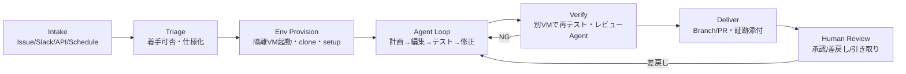

# クラウド型コーディングエージェント / ソフトウェアファクトリー 一般機能調査

- 調査日: 2026-11-06
- 目的: AWS Lambda MicroVMs 上でコーディングエージェントを動かすソフトウェアファクトリーの要件定義に向けて、市場で「当たり前」になっている機能を洗い出す
- 調査対象: Devin, OpenAI Codex (cloud), GitHub Copilot cloud agent, Cursor Cloud Agents, Google Jules, Claude Code on the web, Factory.ai, Warp Factories, Islo, Linear Coding Sessions, GitLab Duo Agent Platform, OpenHands ほか業界記事

---

## 1. 結論サマリ

1. **製品のアーキテクチャはほぼ同じ形に落ち着いている。** 「タスクを受け取る → 隔離VMを起動 → リポジトリをclone → 依存関係を入れる → 編集・テストを回す → PRを作る → 人間がレビュー」というループで、差が出るのはモデルではなく「どこから起動するか」「どこで動くか」「どう引き渡すか」「どう統制するか」。
2. **2026年に入って競争軸が「エージェント単体」から「ファクトリー全体」へ移った。** 受付・トリアージ、多段のオーケストレーション、独立した検証、ガバナンス、ROIの計測までが、エンタープライズで求められる最低ラインになりつつある。
3. **セキュリティは「サンドボックスがあること」ではもう差がつかない。** egress allowlist、**クレデンシャルをVMの中に置かない（プロキシで後付けする）**、エージェントごとの secret / MCP 付与、監査ログが比較のポイントになっている。
4. **Lambda MicroVMs が担えるのは「実行環境」レイヤー。** 隔離・高速起動・suspend/resume・VMごとのHTTPSエンドポイント・IAM実行ロール・VPC接続は標準で揃っている。受付・オーケストレーション・クレデンシャルプロキシ・監査・UI・コスト管理は自分たちで作る必要がある。

---

## 2. 収束した標準ループ

業界記事でよく挙がる教訓は次のとおり。
- 並列で動かすエージェントには**必ず1タスク1サンドボックス**を割り当てる（同じフォルダを共有すると互いに上書きする）。
- エージェントの「テスト通りました」という自己申告は当てにならない。**クリーンなスナップショットから起動した別サンドボックスで検証し直す**。
- 「stuck」「判断待ち」は失敗ではなく、正常な状態として扱う（Warp）。

---

## 3. 機能カテゴリ別の一般要件

凡例: ◎ = ほぼ全製品が持つ基本機能 / ○ = 主要製品の多くが持つ / △ = 先進的・差別化機能

### A. タスク受付（Intake）とトリガー
| 機能 | 普及度 | 代表例 |
|---|---|---|
| Web UI / CLI / IDE からのタスク投入 | ◎ | Codex, Cursor, Claude Code |
| Issue のアサインで起動（GitHub / Jira / Linear） | ◎ | Copilot, Devin, Linear |
| チャットから指示（Slack / Teams） | ○ | Devin, Cursor |
| API / Webhook での起動 | ○ | Devin API, 各種ファクトリー |
| スケジュール実行、自動で再開して作業を続ける | △ | Codex automations, Factory.ai |
| トリアージ段階（実装する / 仕様化する / 保留 の判断、曖昧なIssueは却下） | △ | Warp, MindStudio 事例 |

### B. 実行環境（Development Environment）— Lambda MicroVM が担当するレイヤー
| 機能 | 普及度 | 備考 |
|---|---|---|
| タスクごとに隔離されたVM / コンテナ | ◎ | Devin "Devbox"、Copilot は Actions ランナー |
| 環境定義（イメージ / Dockerfile / setup script） | ◎ | Codex の install script、`copilot-setup-steps.yml` |
| 依存関係キャッシュやスナップショットによる起動の高速化 | ○ | Copilot の起動に90秒以上かかることが不満点として挙がっている |
| プライベートな依存関係・社内レジストリへのアクセス | ○ | VPC 接続が必要 |
| DB やキューなど周辺サービスの立ち上げ | △ | Encore が「一番見落とされがちなレイヤー」と指摘 |
| ブラウザ / GUI を使ったテスト（デスクトップ環境） | △ | Cursor Cloud Agents |
| 数日にまたがる長時間タスクや永続環境 | △ | Factory.ai "multi-day missions" |
| CPU / メモリなどリソースの指定 | ○ | |

### C. エージェント・モデル・コンテキスト
| 機能 | 普及度 | 備考 |
|---|---|---|
| リポジトリの指示ファイル（AGENTS.md / CLAUDE.md）の読み込み | ◎ | lint や test のコマンドもここから読む |
| モデルの選択 | ○ | Copilot は4社15以上のモデル。Devin・Jules は自社モデルに固定 |
| ハーネスの選択（Claude Code / Codex / 自社エージェント） | △ | Copilot が Claude と Codex を統合、Linear、GitLab |
| BYO 推論（Bedrock / Vertex / セルフホスト） | △ | Warp・TrueFoundry が「主権（sovereignty）」の要件として強調 |
| MCP / スキル / エージェントのレジストリ（組織で標準化） | △ | Port, Warp |
| ナレッジやメモリ（組織の知識・過去の学習内容） | ○ | Devin Knowledge, Copilot Memory |

### D. オーケストレーション
| 機能 | 普及度 | 備考 |
|---|---|---|
| 複数タスクの並列実行 | ◎ | |
| 多段のパイプライン（triage → plan → implement → review） | △ | Warp の "foreman"、Islo |
| マネージャーエージェントによるサブエージェントへの分配（fan-out） | △ | MultiDevin |
| 失敗時のリトライやループ、条件付きの遷移 | △ | Islo |
| 承認待ちなど長時間の待機に耐える（durable） | △ | 外部イベントや長い承認待ちに対応 |
| 複数リポジトリにまたがる作業 | △ | |

### E. 検証・品質保証
| 機能 | 普及度 | 備考 |
|---|---|---|
| エージェントが自分で build / test / lint を回す | ◎ | |
| CI との連携（PR に対して CI が走る） | ◎ | Copilot は CI/CD の実行前に承認が必要 |
| レビューエージェントによる差分レビュー | ○ | Devin Review, Cursor Bugbot, Copilot code review |
| 独立した検証環境での再テスト | △ | 自己申告を信用しない設計 |
| 証跡の添付（スクリーンショット、ログ、テスト結果） | ○ | |
| セキュリティスキャン（SAST / SCA / secret 検出） | ○ | |

### F. 人間との協調（Human-in-the-Loop）
| 機能 | 普及度 | 備考 |
|---|---|---|
| 進捗のリアルタイム表示（ログ・思考・差分） | ◎ | |
| 実行中のエージェントへの追加指示（steering） | ○ | |
| 計画の承認（plan mode） | ○ | |
| 環境の引き取り（VS Code / ターミナル / SSH で人が入る） | ○ | Devin の IDE takeover |
| クラウドからローカルへの引き渡し、ローカルからクラウドへの戻し | △ | Warp Factory MCP、Claude Code の teleport 系 |
| 完了や判断待ちの通知（Slack / メール） | ◎ | |

### G. 成果物の引き渡し
| 機能 | 普及度 |
|---|---|
| ブランチ作成と PR / MR の作成（直接 push しない） | ◎ |
| Issue へのコメントやステータス更新 | ◎ |
| PR へのレビューコメントを受けての再修正 | ○ |
| プレビュー環境のデプロイ | △ |

### H. セキュリティ・ガバナンス（エンタープライズ要件の中核）
| 機能 | 普及度 | 代表例と備考 |
|---|---|---|
| ネットワーク egress の制御（デフォルト拒否 + allowlist） | ◎ | Copilot firewall（組織とリポジトリの2階層）、Codex の「パッケージマネージャーのドメインのみ」 |
| **クレデンシャルをVMの中に置かない** | ○ | Claude Code on the web は git をプロキシ経由にし、トークンがコンテナに入らない。"network secret" はプロキシが後付けする |
| エージェントごとの secret / MCP の付与 | ○ | Warp |
| 最小権限（リポジトリ単位のアクセス、読み取り専用） | ◎ | |
| 監査ログ（誰が、何を、どのエージェントで、何をしたか） | ○ | GitHub Agent Control Plane |
| 高リスク操作の前の人間による承認ゲート | ○ | |
| 組織ポリシーの一元管理（SSO / RBAC / 有効化の制御） | ○ | Copilot Enterprise AI Controls |
| データの所在とゼロデータリテンション、自社境界内での実行 | △ | Cursor self-hosted、Claude Managed Agents self-hosted sandbox |

> 参考（Riptides の比較）: 多くのサンドボックスでも、親プロセスの `*_TOKEN` 環境変数や `~/.config/gh/hosts.yml` が見えてしまっていた。**「隔離されていること」と「クレデンシャルが漏れないこと」は別の問題**として設計する必要がある。

### I. 可観測性・コスト・ROI
| 機能 | 普及度 | 備考 |
|---|---|---|
| セッション履歴とリプレイ（全ステップのトレース） | ○ | Warp の "control room" |
| 使用量に応じた課金と予算上限 | ◎ | Devin は ACU、Copilot はクレジット |
| LLM コストとインフラコストを分けて管理 | △ | TrueFoundry |
| 生産性の指標（PRあたりのコスト、サイクルタイム、自動化率、PRあたりの人の介入回数） | △ | Warp が "human touches per PR" を追跡 |
| 自社タスクのリプレイによるベンチマーク、評価、自己改善 | △ | Warp Factory Benchmarks（特定タスクでコストを63%削減と報告） |

### J. 運用・管理
| 機能 | 普及度 |
|---|---|
| マルチテナント（組織 / チーム / プロジェクト） | ○ |
| 環境イメージのバージョン管理 | ○ |
| ファクトリー定義のコード化（versioned / testable / revertible） | △ |
| 自社クラウドへのデプロイ（VPC / アカウント内） | △ |

---

## 4. Lambda MicroVMs で賄える範囲とのマッピング

出典: AWS Compute Blog "Announcing Lambda MicroVMs"、Lambda 開発者ガイド（Running and using MicroVMs / Quotas）、Lambda FAQ

| 一般要件 | MicroVMs の標準機能 | 判定 | 補足・自前で作る部分 |
|---|---|---|---|
| タスクごとの強い隔離 | Firecracker の microVM。セッション間で状態を共有しない | ✅ | |
| 起動の高速化 / 環境定義 | Dockerfile から MicroVM Image を作り、初期化済みの snapshot から起動 | ✅ | 言語・ツールチェーンごとにイメージを用意する。リポジトリ固有の setup は起動後に実行 |
| 状態を保ったままの一時停止 | suspend / resume（メモリとディスクを保持、最大8時間）、idle policy、auto-resume、`/suspend` `/resume` フック | ✅ | 人の承認待ちのあいだ suspend してコストを抑える設計がしやすい |
| 人間による引き取り（IDE / ターミナル） | VMごとの専用 HTTPS エンドポイント（WebSocket / gRPC 対応） | ✅ | SSH over WebSocket や code-server などは自前で実装する（VS Code サーバーなどの既存のサンプルを流用できる） |
| リソース | ベースライン 2GB / 1vCPU から最大 4倍まで自動で縦にスケール。最大 32GB / 16vCPU | ✅ | 大規模ビルドで足りるかは要検証 |
| 並列実行 | 1分以内に数百台を起動できる。東京のメモリクォータは 1,024GB（2GB なら 512台）、4倍までバースト可 | ✅ | 大量に並列で動かすならクォータ引き上げを申請 |
| 最小権限のクラウドアクセス | VMごとの execution role（build role と分離できる） | ✅ | タスクごとにセッションポリシーで権限を絞るなら別途設計 |
| プライベートリソースへのアクセス | Lambda Network Connector (LNC) で VPC egress | ✅ | |
| egress の allowlist | 管理された INTERNET_EGRESS か、LNC 経由で VPC へ | ⚠️ | ドメイン単位の allowlist は MicroVMs 側の機能としては確認できていない。LNC → VPC → Network Firewall / プロキシで実装する想定（**要検証**） |
| クレデンシャルを VM に置かない | — | ❌ | git や API の認証を付け加えるプロキシは自前で用意する。Bedrock は execution role を使えば API キーが不要 |
| 長時間タスク | 1台あたり最大 8時間（上限の引き上げ不可） | ⚠️ | 8時間を超えるタスクは途中で状態を保存し、新しい VM で再開する仕組みが必要 |
| 外部エージェントとの統合 | Claude Managed Agents / Cursor Cloud Agents の self-hosted sandbox として公式に統合されている | ✅ | 「ハーネスを選べる」ことの足がかりになる |
| 受付・オーケストレーション・検証・監査・UI・コスト管理 | — | ❌ | 自前で作る（Step Functions / Lambda Durable Functions / EventBridge / DynamoDB / CloudTrail / CloudWatch などを組み合わせる想定） |

### スナップショット由来の注意点
- イメージ作成時に生成された値（ID、secret、乱数シード）は、そのイメージから起動したすべての VM で同じになる。**起動後に生成し直すこと**。
- 一時的なクレデンシャルや接続は、resume した時点で失効していることがある。`/resume` フックで更新する。
- 課金は compute、snapshot（保存・読込・書込）、データ転送の3つ。イメージの保存には最低1週間分の料金がかかる。

---

## 5. Lambda MicroVMs ベースならではの差別化候補（日本企業向け）

- **お客様の AWS アカウント内で完結する**: コード、ファイルシステム、egress が自社の境界から出ない。東京リージョンで動かせる。
- **Bedrock と IAM による認証**: VM 内に API キーなどの秘密情報を置かずに済む。
- **インフラ管理が不要、使った分だけ支払う**: プールの待機分やクラスタの維持にお金がかからない。suspend 中は snapshot の保存料金だけになる。
- **VM レベルの隔離が速く起動する**: 「Copilot は起動に90秒以上かかる」という不満に対し、snapshot 起動で体験の差を出せる。
- **ハーネスの選択肢が多い**: Claude Code / Codex / Kiro などをイメージ単位で切り替えられ、Claude Managed Agents や Cursor の self-hosted sandbox とも連携できる。

---

## 6. 次のステップで決めるべき論点（要件定義に向けて）

1. **想定するユーザーと用途**: 開発者向けか、LoB の非開発者も含めるか。新規開発、保守、モダナイゼーション（例: Java → サーバーレス移行）のどれを主に扱うか。
2. **入口**: どこから起動するか（GitHub Issue、Slack / Teams、Web UI、CLI(lll)、API）。MVP ではどれに絞るか。
3. **Git ホスト**: GitHub / GitLab / Backlog など。日本企業での採用状況をふまえて決める。
4. **ハーネスとモデル**: Claude Code + Bedrock に固定するか、複数から選べるようにするか。
5. **人の関与の度合い**: 完全に非同期で PR を返すだけか、計画の承認や途中での引き取りまで対応するか。
6. **ネットワークポリシー**: インターネットを完全に遮断する構成、allowlist、社内レジストリのみ、のどれにするか。
7. **オーケストレーションの深さ**: 1タスク1エージェントから始めるか、triage → implement → verify の多段構成にするか。
8. **8時間の上限への対応**: 長いタスクをどう分割し、どう引き継ぐか。
9. **提供形態**: お客様のアカウントにデプロイする形（CDK / SAM）か、SaaS として提供するか。
10. **計測**: ROI の指標（PRあたりのコスト、人の介入回数、トークンあたりの価値）をどこまで最初から組み込むか。

---

## 参考資料
- AWS Compute Blog: Announcing Lambda MicroVMs — https://aws.amazon.com/blogs/compute/announcing-lambda-microvms-serverless-compute-environments-with-vm-level-isolation-and-near-instant-startup/
- Lambda 開発者ガイド: Running and using MicroVMs — https://docs.aws.amazon.com/lambda/latest/dg/microvms-launching.html
- Lambda quotas — https://docs.aws.amazon.com/lambda/latest/dg/gettingstarted-limits.html
- Using Lambda MicroVMs as a sandbox for Claude Managed Agents — https://docs.aws.amazon.com/lambda/latest/dg/microvms-integrations-claude-managed-agents.html
- Using Lambda MicroVMs as a sandbox for Cursor Cloud Agents — https://docs.aws.amazon.com/lambda/latest/dg/microvms-integrations-cursor-self-hosted-machines.html
- Warp: What Is an Enterprise Software Factory? — https://www.warp.dev/articles/enterprise-software-factory
- Incredibuild: What is an enterprise software factory? — https://www.incredibuild.com/blog/what-is-an-enterprise-software-factory-architecture-requirements-and-platforms
- TrueFoundry: The Agentic Software Factory, Explained — https://www.truefoundry.com/blog/software-factory-agentic-enterprise-guide
- Encore: Best AI Software Factory Platforms — https://encore.dev/articles/best-ai-software-factory-platforms
- MindStudio: How to Build a Self-Improving Software Factory — https://www.mindstudio.ai/blog/software-factory-ai-coding-agents
- dreaming.press: Devin vs Codex vs Cursor vs Jules vs Copilot — https://dreaming.press/posts/devin-vs-codex-vs-cursor-vs-jules-background-agents.html
- Claude Code Docs: Configure cloud environments — https://code.claude.com/docs/en/cloud-environments
- GitHub Docs: Customizing the firewall for Copilot coding agent — https://docs.github.com/copilot/how-tos/agents/copilot-coding-agent/customizing-or-disabling-the-firewall-for-copilot-coding-agent
- Riptides: AI coding agent sandboxes compared — https://riptides.io/blog/ai-coding-agent-sandboxes-compared
