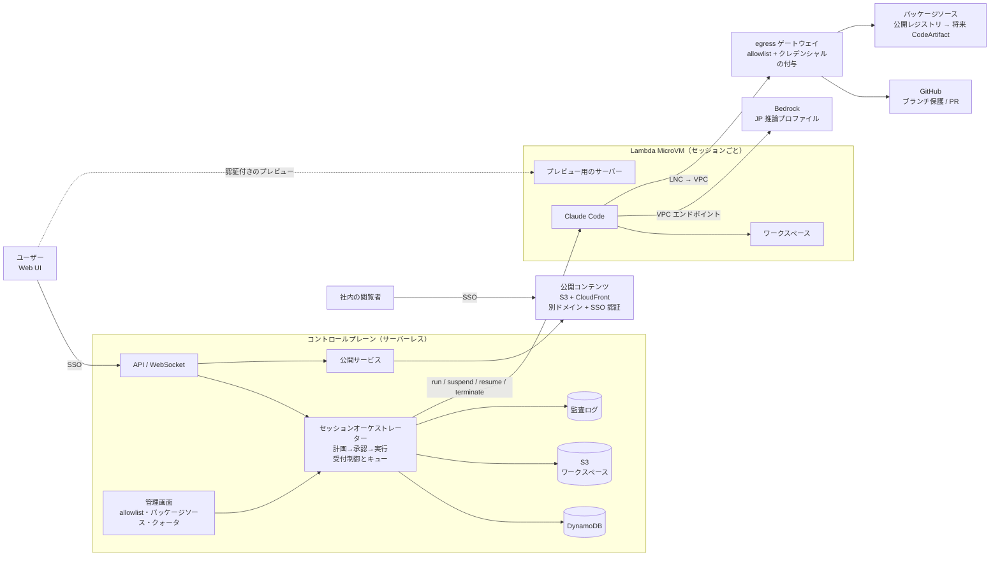

# ソフトウェアファクトリー 要件定義書 v1.0

- 更新日: 2026-11-06
- ステータス: **確定（実装を始める基準とする）**。この後の変更は ADR と PR で管理する
- 前提資料: [01_research_common_features.md](./01_research_common_features.md)
- 変更履歴: v0.1 → v0.2 → v0.3 → v1.0（§0.3 を参照）
- 関連資料: [03_architecture.md](./03_architecture.md)（詳細設計） / [04_implementation_plan.md](./04_implementation_plan.md)（実装計画）

---

## 0. 決定事項と仮置き事項

### 0.1 決定事項
| # | 論点 | 決定内容 | 決定日 |
|---|---|---|---|
| D1 | 想定ユーザー | 開発者に加えて LoB（非開発者）も含める | 11/06 |
| D2 | MVP の入口 | Web UI からチャット形式で指示する。GitHub Issue と Slack には今後対応する | 11/06 |
| D3 | 人の介入 | 計画の承認など、要所でのみ介入する。ファイルの作成や削除といった細かな作業ごとの確認は行わない | 11/06 |
| D4 | ネットワークポリシー | allowlist 方式（許可していない通信はすべて拒否） | 11/06 |
| D5 | UI モード | **LoB 専用のモードは設けない**。全ユーザーが開発者向けの画面を使う | 11/06 |
| D6 | ライブプレビュー | **採用する**（MVP 必須） | 11/06 |
| D7 | LoB の権限 | **LoB ユーザーも既存リポジトリを変更してよい** | 11/06 |
| D8 | 成果物の受け渡し | **ダウンロードに加え、社内への公開・共有も MVP に含める** | 11/06 |
| D9 | パッケージの取得元 | allowlist は設定できるようにする。パッケージは**インターネット上の公開レジストリから取得する**。将来 **CodeArtifact に切り替える**ことを前提に設計する | 11/06 |
| D10 | 規模 | **MVP は10人程度**。AWS のクォータと相談しながら、**最大100人程度**まで使える設計にする | 11/06 |
| D11 | GitHub 連携・公開の対象・推論プロファイル | GitHub 連携は**ユーザーごと**に行う（GitHub App の user-to-server 認可）/ 社内公開は MVP では**静的コンテンツのみ** / Bedrock は **JP の推論プロファイル**を使う | 11/06 |
| D12 | 公開用のドメイン | **CloudFront の既定ドメイン（`*.cloudfront.net`）を使う**。独自ドメインは使わない | 11/06 |
| D13 | AWS アカウント | **新しいアカウントを使う**（クォータの引き上げ申請を早めに出す） | 11/06 |
| D14 | カスタムイメージ | 既定のイメージに加えて、**ユーザーが自分でカスタムイメージを作れる**ようにする | 11/06 |
| D15 | 工程ごとの VM | ファクトリーの**工程（ステージ）ごとに別の VM（別のイメージ）を起動し**、それぞれの VM で異なる作業を行えるようにする | 11/06 |
| D16 | プレビューの制約 | 1つのブラウザで同時に開けるプレビューは1つだけ、という制約を**受け入れる**（MVP） | 11/06 |
| D17 | Git ホスト | **GitHub.com** を使う（GHES には対応しない） | 11/06 |
| D18 | 実行エンジン | **Lambda durable functions** を使う（Step Functions は使わない） | 11/06 |
| D19 | 技術スタック | フロントエンド: **TypeScript / React / Vite / Zustand / MSW（モックの確認用） / Zod**。バックエンド: **TypeScript / Hono** | 11/06 |
| D20 | 画面の構成 | UI モックのパターン **B（会話と成果物を左右に並べるワークスペース）** を採用する | 11/06 |

### 0.2 前提（実装時に変更する場合は ADR を書く）
| # | 論点 | 仮置きの内容 |
|---|---|---|
| A2 | エージェントのハーネス | Claude Code（Agent SDK）を主とし、イメージを差し替えれば他のハーネスにも替えられる構造にする |
| A3 | モデル | Amazon Bedrock（Claude）。認証は IAM で行い、VM 内に API キーを置かない |
| A4 | 提供形態 | お客様の AWS アカウントに CDK でデプロイする（シングルテナント）。東京リージョンを主とする |
| A5 | 認証 | Cognito + 企業 IdP（SAML / OIDC）による SSO |

### 0.2.1 提案中（ADR の承認を待っている）
| # | 論点 | 提案の内容 | ADR |
|---|---|---|---|
| P1 | 依頼の一覧の置き場所 | ホームを一覧（パターン C の表）にし、行を開くとワークスペース（B）に入る | [ADR-0007](./adr/0007-workspace-layout.md) |
| P2 | UI の部品 | AffectUI の無料の部品を取り込んで持つ（型エラーは直す）。Pro は今は買わない | [ADR-0008](./adr/0008-ui-components-and-styling.md) |
| P3 | スタイル | CSS Modules とデザイントークン（CSS 変数） | [ADR-0008](./adr/0008-ui-components-and-styling.md) |
| P4 | モック | MSW の裏に、ラインの実行を流すシミュレーターを持たせる | [ADR-0009](./adr/0009-mock-backend-simulator.md) |

画面の細かい規則（タブ、自動の切り替え、承認の出し方、狭い画面、LoB への配慮）は [06 UI 仕様](./06_ui_spec.md) に書いた。

### 0.3 変更点
- LoB モード（Git を意識させない画面）を廃止し、画面を1種類にした（D5）
- LoB ユーザーに既存リポジトリへの書き込みを解禁した。代わりに、GitHub のブランチ保護とレビュー必須の設定で統制する（D7）
- 社内への公開・共有を Phase 3 から **MVP** に移した（D8）。§2.5 を新設
- パッケージソースを切り替えられる仕組み（プロファイル）を追加した（D9）。§5.3
- 容量の見積もりとクォータの計画を追加した（D10）。§6
- **v1.0**: D16〜D19 を追加した。SDK で確かめた結果を反映した（**VM のサイズはイメージ単位で決まる**ため、FR-ENV-07 と FR-LINE-01 を修正した）
- **v0.3**: A7〜A9 を決定事項にした（D11）。公開用のドメイン（D12）と新しいアカウント（D13）を反映した。**カスタムイメージ（§2.10）とファクトリーライン / 工程ごとの VM（§2.11）を新設した**（D14・D15）。FR-ENV-09 は §2.10 に統合した

---

## 1. ユーザーとユースケース

### 1.1 ペルソナとロール
| ペルソナ | システム上のロール | 特徴 |
|---|---|---|
| P1: LoB ユーザー | **User** | コードは読めない。業務の課題は熟知している。開発者と同じ画面を使う |
| P2: 開発者 | **User** | 既存リポジトリを持ち、PR でレビューする |
| P3: 管理者 | **Admin** | allowlist、パッケージソース、利用者、イメージ、予算、監査を管理する |

> D5 と D7 により、LoB と開発者でシステム上の権限は区別しない。何ができるかは **GitHub 側の権限**と **ブランチ保護**で決まる。

### 1.2 代表的なユースケース
- **UC1**: CSV を添付し、「部署別に集計して、グラフ付きの HTML レポートにして」と依頼 → 計画を承認 → 生成 → プレビュー → **社内に公開して URL を共有する**
- **UC2**: 「申請受付の Web フォームを作って」と依頼 → 計画を承認 → 生成 → **起動中のアプリをライブプレビュー** → チャットで修正を依頼 → ダウンロード
- **UC3**: 「repo X の README と入力チェックを直して」（LoB が既存リポジトリを変更）→ 計画を承認 → 実装 → **PR を作り、コードオーナーがレビューしてマージ**
- **UC4**: 開発者が Issue の修正を依頼 → 計画を承認 → 実装とテスト → PR
- **UC5**: ブラウザを閉じても作業は続き、完了や承認待ちになったら通知が届く。後から再開できる

---

## 2. 機能要件

優先度: **M** = MVP 必須 / **S** = Phase 2（GitHub Issue・Slack 対応の時期） / **C** = Phase 3 以降

### 2.1 チャット UI（FR-UI）
| ID | 要件 | 優先度 |
|---|---|---|
| FR-UI-01 | チャットで指示を出し、エージェントの応答をストリーミングで表示する | M |
| FR-UI-02 | セッションの一覧表示・再開・名前変更・アーカイブ | M |
| FR-UI-03 | ファイルの添付（CSV / Excel / PDF / 画像 / 仕様書など）をワークスペースに取り込む | M |
| FR-UI-04 | 実行状況を表示する（実行中のステップ、コマンド、ログ、変更ファイルの差分）。表示は1種類で、モードの切り替えはない（D5） | M |
| FR-UI-05 | ワークスペースのファイルツリー表示・閲覧 | M |
| FR-UI-06 | **ライブプレビュー**（D6）: VM 内で起動したアプリや HTML を、認証付きの URL で UI に埋め込み、別タブでも開けるようにする | M |
| FR-UI-07 | 実行中のエージェントへの追加指示と中断（steering / stop） | M |
| FR-UI-08 | 目的別のテンプレート（「レポート作成」「Web フォーム」「Issue 修正」など）から始められる | S |
| FR-UI-09 | 日本語の UI（英語は S） | M |

### 2.2 計画と承認（FR-PLAN）
| ID | 要件 | 優先度 |
|---|---|---|
| FR-PLAN-01 | 作業に入る前に、エージェントが**実行計画**を提示する（目的、作るもの・変えるもの、対象リポジトリとブランチ、手順、完了の判断基準、必要な外部アクセス、所要時間とコストの見込み） | M |
| FR-PLAN-02 | 計画の承認・修正依頼・却下ができる。承認後はファイル操作やコマンド実行を**確認なしで自律的に進める** | M |
| FR-PLAN-03 | 計画の冒頭に、非開発者にも分かる平易な言葉の要約を付ける（画面は1種類のままで、文章の書き方で配慮する） | M |
| FR-PLAN-04 | 再承認のトリガー（§4）に当たったら作業を止め、承認を求める | M |
| FR-PLAN-05 | 小さな依頼は計画の承認を省略できる。省略するかどうかの閾値は管理者が設定する | S |

### 2.3 実行環境（FR-ENV）— Lambda MicroVMs
| ID | 要件 | 優先度 |
|---|---|---|
| FR-ENV-01 | 1セッションに1台の MicroVM を割り当て、セッション間で状態を共有しない | M |
| FR-ENV-02 | 管理者が用意した標準イメージ（Node / Python / 主要な CLI を含む汎用イメージ）から snapshot 起動する | M |
| FR-ENV-03 | 操作のない状態が続いたら自動で suspend し、ユーザーが戻ったら自動で resume する | M |
| FR-ENV-04 | **8時間の上限への対応と復元**: 会話履歴と作業状態を VM の外（DynamoDB / S3 / Git の作業ブランチ）に保存し、新しい VM で自動的に再開する | M |
| FR-ENV-05 | 起動時と resume 時のフックで、パッケージソースの設定（§5.3）を生成し、短期クレデンシャルを更新する | M |
| FR-ENV-06 | リポジトリ固有の setup（依存関係のインストールなど）を定義し、自動で実行する | M |
| FR-ENV-07 | VM のサイズ（ベースライン）は**イメージごとに決まる**（`RunMicrovm` では指定できない）。標準は 2GB / 1vCPU で、最大で4倍まで自動でスケールする。大きなサイズ（4GB / 8GB）のイメージを作るには管理者の許可が必要 | M |
| FR-ENV-08 | ブラウザのターミナルや VS Code からの直接アクセス | S |
| FR-ENV-09 | （§2.10 FR-IMG に統合） | — |
| FR-ENV-10 | ヘッドレスブラウザを使った UI テストとスクリーンショットの取得 | S |

### 2.4 リポジトリ連携（FR-REPO）— D7 の具体化
| ID | 要件 | 優先度 |
|---|---|---|
| FR-REPO-01 | ユーザーは自分の GitHub アカウントを連携する（GitHub App の user-to-server 認可）。操作できるのは、**本人の GitHub 権限と、App をインストールしたリポジトリが重なる範囲**に限る | M |
| FR-REPO-02 | 既存リポジトリの変更は、**必ず作業ブランチを作り、PR で返す**。既定ブランチや保護ブランチには push しない（ゲートウェイでも拒否する） | M |
| FR-REPO-03 | 書き込み先のリポジトリに**ブランチ保護（レビュー必須）が設定されていない**場合は、警告を出す。管理者の設定で、その場合は書き込みを禁止することもできる | M |
| FR-REPO-04 | PR の説明を自動で作る（依頼内容の要約、承認された計画、変更点、テスト結果、プレビューのスクリーンショットまたは URL、依頼者名、セッションへのリンク）。レビュアーが、コードを読めない依頼者の意図を確認できるようにする | M |
| FR-REPO-05 | PR に「AI生成」のラベルを付け、依頼者を明記する | M |
| FR-REPO-06 | 新規のワークスペース（リポジトリなし）から始められる。後から新しいリポジトリを作って push できる | M（新規）/ S（リポジトリの作成） |
| FR-REPO-07 | PR へのレビューコメントを受けて再修正する | S |
| FR-REPO-08 | 複数のリポジトリにまたがる変更 | C |

### 2.5 成果物の受け渡しと社内公開（FR-SHARE）— D8 の具体化
| ID | 要件 | 優先度 |
|---|---|---|
| FR-SHARE-01 | ファイル単位またはフォルダ単位でダウンロードできる（zip での一括ダウンロードを含む） | M |
| FR-SHARE-02 | **社内公開**: ワークスペース内のフォルダ（静的コンテンツ）を選んで公開し、固定の URL を発行する | M |
| FR-SHARE-03 | 公開範囲を選べる: ① 社内の全員（SSO 認証済みのユーザー）、② 指定したユーザーまたはグループ。**認証なしで社外に公開することはできない** | M |
| FR-SHARE-04 | 公開は**ユーザーがボタンを押して行う**。エージェントは公開を提案するだけで、自分では公開しない（§4） | M |
| FR-SHARE-05 | 公開前の自動チェック: secret の検出、サイズの上限、許可されていない外部ドメインの参照（CDN の JS など）への警告 | M |
| FR-SHARE-06 | 公開中のコンテンツの一覧表示、更新（再公開してバージョンを上げる）、公開停止、有効期限の設定 | M |
| FR-SHARE-07 | 監査: 誰が・いつ・何を・どの範囲で公開したかを記録する。閲覧ログ（アクセスログ）も残す | M |
| FR-SHARE-08 | 公開コンテンツは**コントロールプレーンとは別のドメインやオリジン**から配信し、CSP を設定して、公開物から認証情報を盗まれないようにする | M |
| FR-SHARE-09 | セッションそのものの共有（閲覧のみ / 共同編集） | S |
| FR-SHARE-10 | 動的なアプリの常時公開（社内向けのホスティング） | C |

### 2.6 エージェント（FR-AG）
| ID | 要件 | 優先度 |
|---|---|---|
| FR-AG-01 | VM 内でエージェントを動かす。サンドボックス内での操作は確認なしで実行する（D3） | M |
| FR-AG-02 | リポジトリの指示ファイル（AGENTS.md / CLAUDE.md）を読み込む | M |
| FR-AG-03 | 完了前にテストや lint を自分で実行し、結果を証跡として残す | M |
| FR-AG-04 | 組織共通の指示（規約、PR の書き方、禁止事項）を注入する | M |
| FR-AG-05 | 管理者が承認した MCP サーバーやスキルだけを使えるようにする（レジストリ方式） | S |
| FR-AG-06 | 独立した検証ステップ（別の VM で再テストし、レビューエージェントが確認する） | S |
| FR-AG-07 | タスクに応じてモデルを使い分ける（軽い作業には軽量モデル） | S |

### 2.7 入口と通知（FR-IN / FR-NT）
| ID | 要件 | 優先度 |
|---|---|---|
| FR-IN-01 | Web UI でのチャット | M |
| FR-IN-02 | 内部 API（Web UI もこれを使う）。今後追加する入口はすべてこの API を通す | M |
| FR-IN-03 | GitHub Issue のアサインやコメントでの @メンションで起動する | S |
| FR-IN-04 | Slack で依頼を受け、スレッドで計画の承認と完了通知を行う | S |
| FR-NT-01 | 承認待ち、完了、失敗、PR の作成をメールまたは UI で通知する | M |
| FR-NT-02 | Slack / Teams への通知 | S |

### 2.8 セキュリティとガバナンス（FR-SEC）
| ID | 要件 | 優先度 |
|---|---|---|
| FR-SEC-01 | SSO でログインする | M |
| FR-SEC-02 | ロール: User / Admin。リポジトリに対する権限は GitHub 側に任せる（FR-REPO-01） | M |
| FR-SEC-03 | egress allowlist（§5） | M |
| FR-SEC-04 | クレデンシャルを VM に置かない（GitHub トークンはゲートウェイが付け加える。AWS や Bedrock は execution role、CodeArtifact のトークンは起動時に role から取得する） | M |
| FR-SEC-05 | VM の execution role は最小権限にする（Bedrock の呼び出しと、自分のワークスペースのプレフィックスだけにアクセスできる） | M |
| FR-SEC-06 | 監査ログ（承認、コマンド、通信の許可と拒否、PR の作成、公開と公開停止、ダウンロード）を、改ざんを防ぐ形で保存する | M |
| FR-SEC-07 | 統制は**エージェントが回避できないインフラの境界で行う**（ネットワーク、IAM、GitHub のブランチ保護、公開はユーザーの操作に限ること） | M |
| FR-SEC-08 | 保存時と通信時の暗号化（KMS） | M |
| FR-SEC-09 | 依存関係の脆弱性スキャン | S |
| FR-SEC-10 | データの保持期間を設定できる | S |

### 2.9 コストと容量（FR-COST）
| ID | 要件 | 優先度 |
|---|---|---|
| FR-COST-01 | セッション単位で、トークン使用量、VM の稼働時間、概算コストを表示する | M |
| FR-COST-02 | セッションごとの予算の上限。上限に達したら作業を止めて承認を求める | M |
| FR-COST-03 | **ユーザーごとの同時セッション数の上限**（running と suspended の合計。初期値は3）と、**同時に実行できるエージェント数の上限**（初期値は1。超えた分は順番待ちにする） | M |
| FR-COST-04 | 管理者ダッシュボード（利用者数、セッション数、MicroVM のメモリ使用量とクォータに対する比率、Bedrock の TPM 使用率、コスト） | M（簡易版）/ S |
| FR-COST-05 | ユーザー別や部署別の予算 | S |

### 2.10 カスタムイメージ（FR-IMG）— D14
| ID | 要件 | 優先度 |
|---|---|---|
| FR-IMG-01 | 管理者が保守する**既定のイメージ**（base / web: Node と Chromium / data: Python のデータ処理ツール）を用意する | M |
| FR-IMG-02 | **ユーザーがカスタムイメージを作れる**。作り方は2通り: ① 宣言的な定義（OS パッケージ、npm / pip のパッケージ、ツール、追加するファイル、**ベースラインのメモリ**）、② Dockerfile の断片（RUN / COPY / ENV など） | M |
| FR-IMG-03 | プラットフォームが用意するベース層（ファクトリーの実行エージェント、CA 証明書、lifecycle hooks、パッケージソースの設定）は**どのイメージにも必ず入れる**。ユーザーが外したり上書きしたりはできない | M |
| FR-IMG-04 | ビルドを UI と API から実行できる。ビルドの進み具合とログを表示する | M |
| FR-IMG-05 | ビルド中の通信も allowlist の対象にする（ビルド用の egress プロファイル）。ビルドに secret は渡さない | M |
| FR-IMG-06 | ビルド後の自動検証（`/validate` フックで、エージェントが起動するか、ワークスペースに書き込めるか、プロキシにつながるかを確かめる）。失敗したら公開しない | M |
| FR-IMG-07 | バージョン管理: 一度作ったバージョンは変更しない。ステージにはバージョンを固定して指定し、古いバージョンにも戻せる | M |
| FR-IMG-08 | 公開範囲: 個人 / プロジェクト / 組織。**組織全体に公開するには管理者の承認が必要** | M（個人・プロジェクト）/ S（組織） |
| FR-IMG-09 | 上限と整理: ユーザーごとのイメージ数の上限。使われていないバージョンを自動で整理する（アカウントのクォータは、イメージ100個 / 1イメージあたり50バージョン / 同時ビルド10） | M |
| FR-IMG-10 | SBOM を作り、脆弱性をスキャンする | S |
| FR-IMG-11 | エージェントが、セッション中に作業内容からカスタムイメージの定義を提案する（「この環境をイメージにする」） | C |

### 2.11 ファクトリーラインと工程ごとの VM（FR-LINE）— D15
| ID | 要件 | 優先度 |
|---|---|---|
| FR-LINE-01 | **ファクトリーライン**（工程を順につないだ定義）を YAML / JSON で記述する。各ステージには、種類（エージェント / 決まった処理 / 人の承認）、**イメージ@バージョン**（VM のサイズもこれで決まる）、ネットワークプロファイル、IAM ロールのプロファイル、ハーネスとモデル、指示とスキル、入力と出力、タイムアウト、遷移の条件（成功 / 失敗 / 指定したステージに戻る（回数の上限付き））を設定する | M |
| FR-LINE-02 | 実行エンジンは**ステージごとに別の MicroVM を起動する**。同じ VM を次のステージで使い続ける指定もできる | M |
| FR-LINE-03 | ステージ間の受け渡し: コードは Git（作業ブランチと `git bundle`）で、それ以外の成果物は成果物ストア（S3）で、要約と結果は構造化した引き継ぎ記録で渡す | M |
| FR-LINE-04 | 標準のライン: `chat`（作業台のステージ1つ: 計画 → 承認 → 実装 → プレビュー → 引き渡し）を MVP の既定にする | M |
| FR-LINE-05 | 多段のラインのサンプル: `build-verify`（実装 → **別の VM で検証** → レビュー → 引き渡し）。複数の VM と複数のイメージが動くことを MVP で実証する | M |
| FR-LINE-06 | ラインの登録: MVP では管理者が YAML を登録する。ユーザーがラインを作ること、ビジュアルエディタは S | M（管理者）/ S（ユーザー） |
| FR-LINE-07 | チャットとの関係: チャットのセッションは「ワークアイテム」として1本のラインを流れる。どのステージを実行中か、ステージごとのログと成果物を UI に表示する | M |
| FR-LINE-08 | 実行中のステージへの介入（ステージのやり直し、スキップ、ラインの中断） | M（中断・やり直し）/ S（スキップ） |
| FR-LINE-09 | ステージの並列実行（fan-out / fan-in） | C |
| FR-LINE-10 | GitHub Issue や Slack から起動したときに使うラインを指定する | S |

### 2.12 管理機能（FR-ADM）
| ID | 要件 | 優先度 |
|---|---|---|
| FR-ADM-01 | allowlist の管理（ネットワークプロファイル: 組織全体 / プロジェクト / ステージ / ビルド用） | M |
| FR-ADM-02 | パッケージソースのプロファイルの管理（§5.3） | M |
| FR-ADM-03 | ユーザー、ロール、プロジェクトの管理 | M |
| FR-ADM-04 | 既定のイメージの保守。カスタムイメージの一覧表示、無効化、組織全体への公開の承認（S） | M |
| FR-ADM-05 | ファクトリーラインの登録とバージョン管理 | M |
| FR-ADM-06 | 実行中の VM とワークアイテムの一覧表示、強制停止 | M |
| FR-ADM-07 | クォータの使用状況（MicroVM のメモリ、Bedrock の TPM、イメージ数）とキューの状況の表示 | M |
| FR-ADM-08 | MCP とスキルのレジストリの管理 | S |

---

## 3. 非機能要件

| ID | 区分 | 要件（初期目標値。PoC で検証） |
|---|---|---|
| NFR-01 | 性能 | 新しいセッションで最初の応答が返るまで10秒以内。resume して応答が返るまで5秒以内。8時間を超えて新しい VM で復元する場合は60秒以内 |
| NFR-02 | 規模 | **MVP: 利用者10人 / 同時セッション30。設計上の上限: 利用者100人 / 同時セッション300**（§6） |
| NFR-03 | 規模 | 規模を増やすときは、設定変更とクォータ引き上げの申請だけで済み、アーキテクチャを変えずに対応できる |
| NFR-04 | 可用性 | コントロールプレーンは 99.9%。VM が障害を起こしても FR-ENV-04 の仕組みで復元できる |
| NFR-05 | 耐久性 | 会話履歴、計画、承認記録、成果物、公開物は VM の外に保存する |
| NFR-06 | セキュリティ | VM 間とユーザー間の隔離。プレビューと公開物へのアクセスには必ず認証を求める。公開物は別のオリジンから配信する |
| NFR-07 | コスト | 操作のない状態が15分続いたら suspend する。suspend したまま一定時間（初期値2時間）が過ぎたら VM を終了してクォータを空ける（状態は外部に保存してあるので、後で復元できる） |
| NFR-08 | 運用 | すべて IaC（CDK）で管理する。サーバーレス中心にする |
| NFR-09 | 可観測性 | セッション単位のトレース。クォータの使用率を監視し、80% を超えたらアラームを出す |
| NFR-10 | 使いやすさ | LoB ユーザーが研修なしで UC1（集計して公開まで）を完了できる |
| NFR-11 | 準拠性 | データはリージョン内（Bedrock は JP の推論プロファイル）に留める。外部への送信は allowlist に載せた宛先のみ |

---

## 4. 人の介入ポリシー

| 区分 | 操作の例 | 扱い |
|---|---|---|
| 確認なしで実行 | VM 内でのファイル作成・編集・削除、コマンドの実行、パッケージのインストール（allowlist の範囲内）、テストの実行、作業ブランチへの commit / push、プレビューの起動 | 自動で実行し、ログに残す |
| **計画の承認** | 作業の開始 | 必須 |
| **再承認** | ① 計画の範囲を外れる（対象リポジトリや主要な成果物が増える）／ ② allowlist にない宛先が必要になった ／ ③ 予算の上限に達した ／ ④ 想定時間を大幅に超えそう | 作業を止めて承認を求める |
| **ユーザーの操作に限定** | **社内公開と公開範囲の変更**、PR の作成後のマージ | エージェントは提案するだけ。公開の API はユーザーのセッションからしか呼べないようにする |
| 物理的に不可 | 保護ブランチへの push、社外への公開、allowlist の変更 | ゲートウェイ、IAM、GitHub のルールで拒否する |

---

## 5. ネットワーク allowlist とパッケージソース

### 5.1 allowlist の階層
| 階層 | 内容 | 管理者 |
|---|---|---|
| L0 システム必須 | Bedrock（VPC エンドポイント）、コントロールプレーン、S3（VPC エンドポイント）、GitHub（ゲートウェイがクレデンシャルを付け加える） | プラットフォーム（変更不可） |
| L1 組織のベースライン | **パッケージソースのプロファイル**（§5.3）で決まる宛先 + 管理者が追加した宛先 | Admin |
| L2 プロジェクト単位の追加 | プロジェクト固有の API やデータソース | Admin |
| L3 セッション単位の一時許可 | 作業中に必要になった宛先 | 再承認を経て一時的に許可する（S） |

### 5.2 要件
- デフォルトは拒否。FQDN とワイルドカードで指定する。設定は管理画面で変更し、反映はセッション単位で、数分以内に行う
- 拒否した通信をログに残し、エージェントには「ブロックされた」ことが分かる形で返す
- egress ゲートウェイが、allowlist の判定とクレデンシャルの付与をまとめて担う
- 実装方式: MicroVM → LNC → **NAT へのルートがない subnet** → 明示的な HTTPS プロキシ（Fargate）→ NAT。詳しくは [03_architecture.md](./03_architecture.md) §6 を参照（PoC の V1 で検証する）

### 5.3 パッケージソースのプロファイル（D9 の具体化）
レジストリの指定を**イメージに埋め込まず**、管理者が設定するプロファイルから VM の起動時に生成する。こうしておけば、公開レジストリから CodeArtifact へ**イメージを作り直さずに切り替えられる**。

| 項目 | `public`（MVP の既定） | `codeartifact`（将来） |
|---|---|---|
| npm | registry.npmjs.org | CodeArtifact の npm エンドポイント |
| Python | pypi.org, files.pythonhosted.org | CodeArtifact の PyPI エンドポイント |
| その他 | Maven Central、proxy.golang.org、crates.io など（言語を追加するたびに増やす） | CodeArtifact（upstream で公開レジストリにつなぐ） |
| OS パッケージ | AL2023 のリポジトリ | 同じ |
| 認証 | なし | 起動時と resume 時のフックで、**execution role を使って CodeArtifact のトークンを取得する**（VM に保存する secret はない） |
| allowlist への反映 | 公開レジストリを L1 に自動で追加する | 公開レジストリを外し、CodeArtifact の VPC エンドポイントに限定する |

要件:
- **FR-PKG-01（M）**: 起動フックで `.npmrc`、`pip.conf` / `UV_INDEX_URL`、`~/.m2/settings.xml` などをプロファイルから生成する
- **FR-PKG-02（M）**: プロファイルは組織単位で設定する（プロジェクト単位の上書きは S）
- **FR-PKG-03（S）**: `codeartifact` プロファイルの実装。トークンは有効期限が切れる前に resume フックで更新する
- **FR-PKG-04（S）**: 切り替え時の注意点を確認する。ロックファイル（`package-lock.json` の `resolved` など）に公開レジストリの URL がそのまま書かれている場合の挙動を検証する

---

## 6. 容量の見積もりとクォータの計画（D10）

### 6.1 Lambda MicroVMs（東京リージョン）
出典: [Lambda quotas](https://docs.aws.amazon.com/lambda/latest/dg/gettingstarted-limits.html)

| クォータ | 既定値 | MVP（10人） | 上限（100人） | 判定と対策 |
|---|---|---|---|---|
| MicroVM 全体に割り当てるメモリ（running と suspended の合計） | **1,024GB**（引き上げ可。4倍までバーストできる） | 10人 × 3セッション × 2GB = **60GB（6%）** | 100人 × 3 × 2GB = **600GB（59%）** | ✅ 既定値で収まる。標準を 4GB にすると 1,200GB で超えるため、**2GB を標準とし、大きな構成は許可制にする**（FR-ENV-07） |
| 1台あたりの最大実行時間 | 8時間（引き上げ不可） | — | — | FR-ENV-04 の復元で対応する |
| RunMicrovm | 5 TPS | 数件 / 分 | 朝に集中しても 1〜2 TPS | ✅ 起動要求はキューに入れ、指数バックオフで再試行する |
| ResumeMicrovm / SuspendMicrovm | 5 / 2 TPS | — | — | ✅ suspend は idle policy に任せ、API はなるべく呼ばない |
| CreateMicrovmAuthToken | 50 TPS | — | — | ✅ プレビューのトークンはセッション単位でキャッシュする |
| 1台あたりの同時接続数と RPS | 150接続〜 / 40 RPS（4vCPU のとき） | — | — | プレビューは本人と少人数での確認に限る。**多くの人が見る用途は社内公開（S3 から配信）に回す**（FR-SHARE） |
| 同時に実行できるイメージビルド | 10 | — | — | ✅ |

> ⚠️ 新しい AWS アカウントでは、クォータが既定値より低く設定されている。使うアカウントの実際の値を Service Quotas で確認すること。

### 6.2 Amazon Bedrock（ボトルネックになる可能性が高い）
- 必要な TPM = **同時に動いているエージェント数 × エージェント1台あたりの平均 TPM**
- 同時に動くエージェント数は FR-COST-03 で制御する（1ユーザー1台まで + システム全体の上限。超えた分は順番待ち）
  - MVP: 最大10台。上限構成: 100人のうち 20〜30% が同時に使うとして 20〜30台
- 1台あたりの TPM は**MVP で実際に測る**（コーディングエージェントは扱うコンテキストが大きく、作業内容によって大きく変わる）
  - 例（仮の値）: 1台あたり平均 100K TPM なら、30台で 3M TPM が必要になる
- 確認するクォータ: 「Cross-Region InvokeModel tokens per minute」（モデル別）、「Cross-Model Max Tokens Per Day」（アカウント単位）
- 対策: ① クォータの引き上げを早めに申請する、② JP クロスリージョン推論を使う、③ prompt caching、④ 軽い作業には軽量モデルを使う（FR-AG-07）、⑤ スロットリングされたら順番待ちにして UI に表示する

### 6.3 推論プロファイルの方針（D11）
- 既定: **JP の地理的クロスリージョン推論**（データの処理を日本国内に留める）
- スループットが足りない場合: Global の推論プロファイルを検討する。データの所在に関する要件と照らし合わせて、お客様の承認を得てから使う

---

## 7. 全体アーキテクチャ（概念）

---

## 8. MVP のスコープ

**含めるもの**: Web チャット、計画の承認と再承認、1セッションに1台の MicroVM、suspend / resume と復元、ファイルの添付とダウンロード、**ライブプレビュー**、**既存リポジトリの変更（ブランチと PR。全ユーザー）**、新規ワークスペース、**静的コンテンツの社内公開**、allowlist（L0〜L2）、パッケージソースのプロファイル（`public`）、VM 内にクレデンシャルを置かない、SSO と User / Admin のロール、監査ログ、セッション単位のコストと上限、同時実行の制御、簡易な管理ダッシュボード、メール通知、**既定のイメージとユーザーが作るカスタムイメージ（個人・プロジェクト）**、**ファクトリーラインの実行エンジン（ステージごとの VM）と標準のライン（chat / build-verify）**。

**含めないもの（Phase 2 以降）**: GitHub Issue と Slack、ターミナルや VS Code からの直接アクセス、イメージの組織全体への公開、ユーザーによるライン作成とビジュアルエディタ、MCP レジストリ、CodeArtifact プロファイル、L3 の一時許可、部署別の予算、動的アプリの公開（C）。

---

## 9. PoC で検証すること

| # | 検証項目 | 関連する要件 |
|---|---|---|
| V1 | LNC → VPC → Network Firewall / プロキシでドメイン単位の allowlist を実現できるか。GitHub トークンを付け加えられるか | FR-SEC-03 / 04 |
| V2 | プレビュー用の認証トークンを使って、UI に埋め込んだり別タブで開いたりできるか | FR-UI-06 |
| V3 | snapshot 起動、resume、8時間後の復元にかかる時間 | NFR-01 |
| V4 | **エージェント1台あたりの TPM**（典型的なタスク3種類で測る） | §6.2 |
| V5 | auto-resume が ResumeMicrovm の API レート制限の対象になるか | §6.1 |
| V6 | suspended の VM がメモリのクォータにどう数えられるか（バーストした分を含めるか） | §6.1 |
| V7 | GitHub App の user-to-server トークンをゲートウェイで付け加える方式の実装と、トークンの更新 | FR-REPO-01 |
| V8 | 公開コンテンツへの SSO 認証の方式（CloudFront + Lambda@Edge か、ほかの方式か） | FR-SHARE-03 |

---

## 10. 未決事項
未決事項と、PoC で検証する項目は [03_architecture.md](./03_architecture.md) の §13・§14 で管理する。
